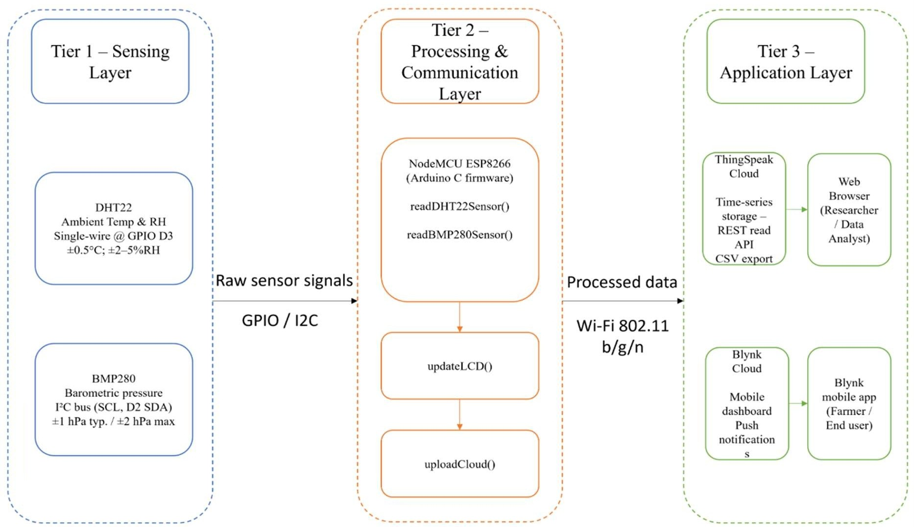

# IoT weather node vs IMD reference station

Code and data for our paper submitted to IEEE APSCON 2027:
"Characterizing Radiation Error and Correcting Seasonal Bias in a Low-Cost IoT Weather Node Against an IMD Reference Station" (A. Kumar, H. Sharma).

NodeMCU ESP8266 with DHT22 and BMP280, Jaipur, Sep 2025 - Jan 2026, compared with IMD Jaipur Airport (VIJP).



## Run

```
pip install -r requirements.txt
python src/run_all.py
```

Tables go to `results/`, figures to `figures/`.

## Hardware

Arduino sketch in `firmware/`. Photos and wiring diagram in `images/`.

## Data

`data/matched_pairs.csv` - 1,119 matched three-hourly pairs (node and IMD).
`data/cloud_okta_VIJP_2025-11_to_2026-01.xlsx` - IMD cloud cover, Nov 2025 - Jan 2026.

IMD data provided by Meteorological Centre Jaipur, shared with permission.
